<picture>
  <source media="(prefers-color-scheme: dark)" srcset="./assets/pro/header-dark.svg" />
  <source media="(prefers-color-scheme: light)" srcset="./assets/pro/header-light.svg" />
  
</picture>

  <a href="https://www.linkedin.com/in/ibraheemayub"><picture><source media="(prefers-color-scheme: dark)" srcset="./assets/pro/btn-linkedin-dark.svg" /><source media="(prefers-color-scheme: light)" srcset="./assets/pro/btn-linkedin-light.svg" /></picture></a>
  <a href="https://aliph.studio"><picture><source media="(prefers-color-scheme: dark)" srcset="./assets/pro/btn-website-dark.svg" /><source media="(prefers-color-scheme: light)" srcset="./assets/pro/btn-website-light.svg" /></picture></a>
  <a href="https://github.com/ibbii-dev"><picture><source media="(prefers-color-scheme: dark)" srcset="./assets/pro/btn-github-dark.svg" /><source media="(prefers-color-scheme: light)" srcset="./assets/pro/btn-github-light.svg" /></picture></a>

## About

I'm a **Full Stack Engineer at Dev Valley**, building scalable web and mobile applications end to end — from MongoDB schemas and Node.js APIs to fast React interfaces and cross-platform Flutter apps. I care about shipping products that are reliable, quick to load, and easy to find, which is why AI integration and technical SEO are part of how I build.

- **Currently:** building full-stack products at Dev Valley
- **Focus:** scalable MERN applications · Flutter apps · AI-powered features · SEO & performance
- **Powered by:** coffee, cats, music, and clean code
- **Open to:** collaborations and interesting projects

## My formula

<picture>
  <source media="(prefers-color-scheme: dark)" srcset="./assets/pro/formula-dark.svg" />
  <source media="(prefers-color-scheme: light)" srcset="./assets/pro/formula-light.svg" />
  
</picture>

## What I do

<picture>
  <source media="(prefers-color-scheme: dark)" srcset="./assets/pro/services-dark.svg" />
  <source media="(prefers-color-scheme: light)" srcset="./assets/pro/services-light.svg" />
  
</picture>

## Tech stack

  

## Dev wall

<picture>
  <source media="(prefers-color-scheme: dark)" srcset="./assets/pro/wall-dark.svg" />
  <source media="(prefers-color-scheme: light)" srcset="./assets/pro/wall-light.svg" />
  
</picture>

## GitHub activity

<picture>
  <source media="(prefers-color-scheme: dark)" srcset="https://raw.githubusercontent.com/ibbii-dev/ibbii-dev/output/heatmap-pro-dark.svg" />
  <source media="(prefers-color-scheme: light)" srcset="https://raw.githubusercontent.com/ibbii-dev/ibbii-dev/output/heatmap-pro-light.svg" />
  
</picture>

  <picture>
    <source media="(prefers-color-scheme: dark)" srcset="https://github-readme-stats.vercel.app/api?username=ibbii-dev&show_icons=true&hide_border=true&hide_rank=true&bg_color=0d1117&title_color=58a6ff&icon_color=58a6ff&text_color=c9d1d9" />
    <source media="(prefers-color-scheme: light)" srcset="https://github-readme-stats.vercel.app/api?username=ibbii-dev&show_icons=true&hide_border=true&hide_rank=true&bg_color=ffffff&title_color=0969da&icon_color=0969da&text_color=1f2328" />
    
  </picture>
  <picture>
    <source media="(prefers-color-scheme: dark)" srcset="https://streak-stats.demolab.com?user=ibbii-dev&hide_border=true&background=0d1117&ring=2f81f7&fire=8b5cf6&currStreakNum=f0f6fc&sideNums=58a6ff&currStreakLabel=58a6ff&sideLabels=c9d1d9&dates=7d8590&stroke=30363d" />
    <source media="(prefers-color-scheme: light)" srcset="https://streak-stats.demolab.com?user=ibbii-dev&hide_border=true&background=ffffff&ring=0969da&fire=8b5cf6&currStreakNum=1f2328&sideNums=0969da&currStreakLabel=0969da&sideLabels=1f2328&dates=656d76&stroke=d0d7de" />
    
  </picture>

<picture>
  <source media="(prefers-color-scheme: dark)" srcset="https://github-readme-activity-graph.vercel.app/graph?username=ibbii-dev&hide_border=true&bg_color=0d1117&color=c9d1d9&line=2f81f7&point=8b5cf6&area=true&area_color=2f81f7&title_color=58a6ff&custom_title=Daily%20Contributions" />
  <source media="(prefers-color-scheme: light)" srcset="https://github-readme-activity-graph.vercel.app/graph?username=ibbii-dev&hide_border=true&bg_color=ffffff&color=1f2328&line=0969da&point=8b5cf6&area=true&area_color=0969da&title_color=0969da&custom_title=Daily%20Contributions" />
  
</picture>

<picture>
  <source media="(prefers-color-scheme: dark)" srcset="./assets/pro/footer-dark.svg" />
  <source media="(prefers-color-scheme: light)" srcset="./assets/pro/footer-light.svg" />
  
</picture>
